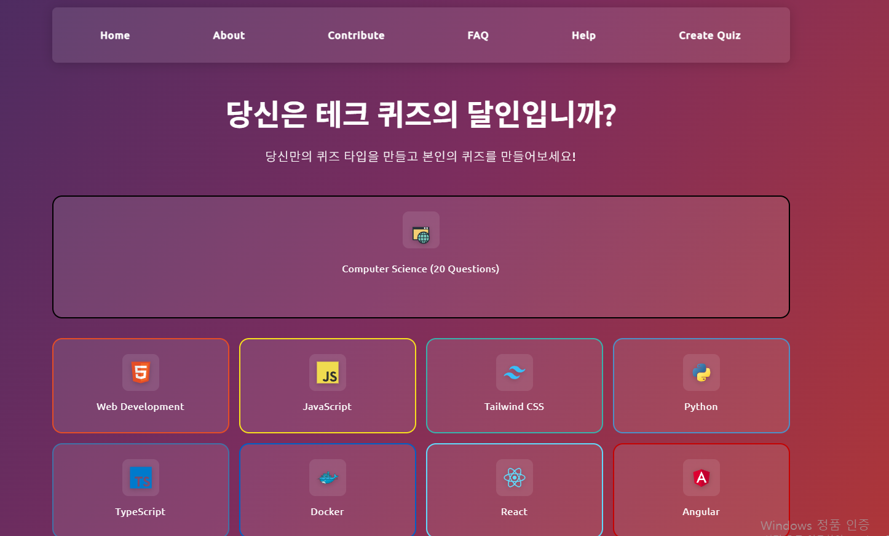
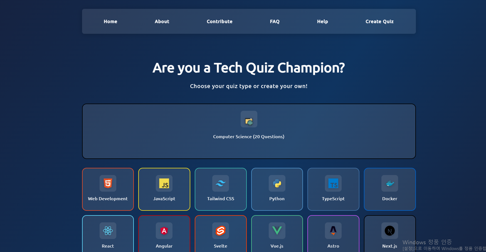
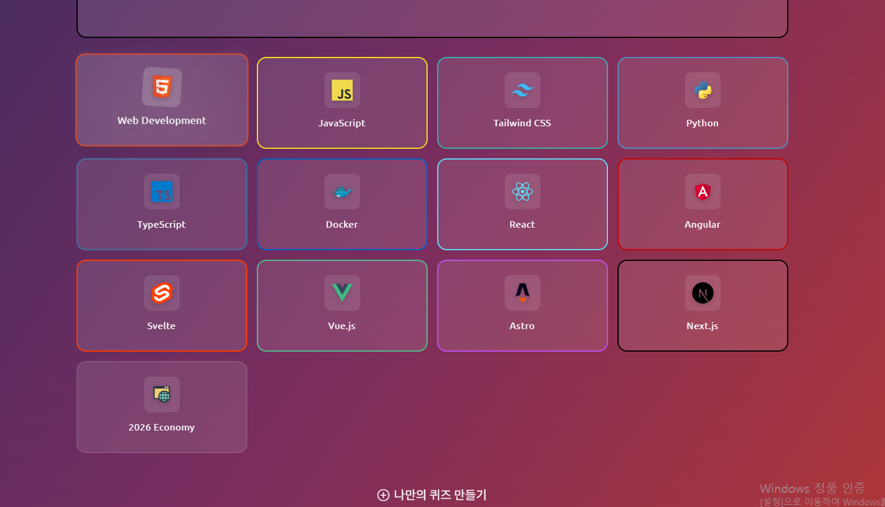
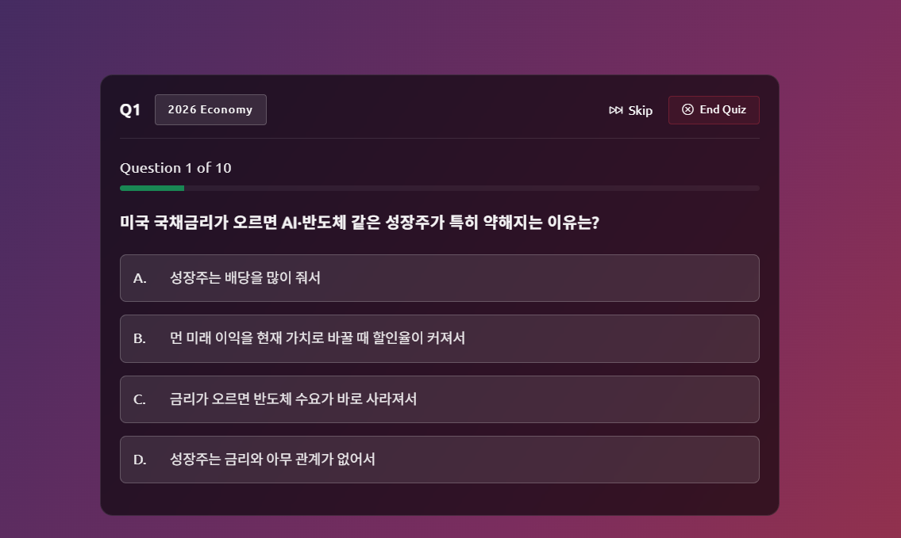

## 1. Project Information

이번 과제에서는 React로 만들어진 퀴즈 웹사이트를 클론하고, 기존 코드를 분석한 뒤 일부 기능과 디자인을 수정하였습니다.

이 프로젝트를 선택한 이유는 기존 todlist나 crud 관련 영화리스트 같은 오픈소스는 많이 건들여봤기에 색다른 것을 해보고 싶었고 퀴즈 문제를 직접 만들어 추가할 수 있다는 점이 흥미로웠기에 선정하였습니다

- Original GitHub: https://github.com/offensive-vk/reactjs-quiz-app
- My GitHub: https://github.com/2026-2-OSS/assign10-c02-22500076.git
- License: MIT License

## 2. Installation

GitHub에서 프로젝트를 클론한 후 필요한 패키지를 설치하고 실행하였습니다.

```bash
git clone https://github.com/2026-2-OSS/assign10-c02-22500076.git
cd assign10-c02-22500076
npm install
npm run dev
```

실행 후 터미널에 표시된 로컬 주소로 접속하여 퀴즈 화면을 확인할 수 있습니다.



## 3. Source Code Exploration

프로젝트를 살펴보면서 주요 파일들이 각각 어떤 역할을 하는지 확인하였습니다.

- `Start.jsx`: 퀴즈 시작 화면을 구성하는 파일입니다. 제목, 설명, 버튼 등의 내용이 들어 있습니다.
- `Start.css`: 시작 화면의 디자인을 담당하며 퀴즈 카드의 배치 등을 설정합니다.
- `index.css`: 전체적인 배경색과 스타일을 설정합니다.
- `quizTypes.js`: 퀴즈 종류와 이름, 아이콘 등의 정보를 관리합니다.
- `public/data`: 실제 퀴즈 문제들이 JSON 파일로 저장되어 있습니다.
- `BaseLayout.jsx`: 여러 화면에서 공통으로 사용하는 레이아웃을 구성합니다.

코드를 분석하면서 React에서는 화면을 컴포넌트 단위로 나누어 관리하고, CSS를 통해 디자인을 변경한다는 것을 확인하였습니다. 또한 퀴즈 종류를 정의하는 파일과 실제 문제 데이터를 저장하는 파일이 분리되어 있다는 점도 알게 되었습니다.

코드 분석: src/components/Start.jsx

```jsx
{quizTypes.slice(1).map((type) => (
  <button
    key={type.id}
    onClick={() => handleQuizStart(type.id)}
    className="quiz-type-card"
    data-type={type.id}
  >
    <div className="quiz-icon-wrapper">
      
    </div>
    <h3 className="quiz-type-title">{type.title}</h3>
  </button>
))}
```

이 코드는 퀴즈 종류를 화면에 카드로 보여주는 부분입니다. 첫 번째 퀴즈는 위에서 따로 크게 표시하기 때문에 slice(1)로 제외하고, 나머지는 map()으로 하나씩 버튼을 만듭니다. type.icon과 type.title을 이용해서 각 카드에 아이콘과 이름을 표시합니다. key에는 각 퀴즈의 id를 넣어 React가 카드를 구분할 수 있게 합니다.

카드를 누르면 해당 퀴즈의 id를 전달하면서 handleQuizStart 함수가 실행됩니다. 이 함수는 로딩 상태를 켜고 loadQuestions를 호출한 뒤, 2초 후 선택한 퀴즈의 페이지로 이동합니다. 새로 추가한 경제 퀴즈도 퀴즈 목록에 등록되어 있기 때문에 이 코드를 통해 카드로 표시됩니다.

## 4. Customizing

### 1) 시작 화면 텍스트 변경

수정 파일: `src/components/Start.jsx`

기존에는 시작 화면이 영어로 되어 있었는데, 한국어 사용자가 쉽게 이해할 수 있도록 몇몇 문구를 한국어로 변경하였습니다.

- Are you a Tech Quiz Champion? → 당신은 테크 퀴즈의 달인입니까?
- Choose your quiz type or create your own! → 당신만의 퀴즈 타입을 만들고 본인의 퀴즈를 만들어보세요!
- Create Custom Quiz → 나만의 퀴즈 만들기

수정 전:



수정 후:




### 2) 화면 디자인 변경

수정 파일: `src/styles/Start.css`, `src/index.css`

먼저 시작 화면에서 퀴즈 카드가 한 줄에 6개씩 표시되던 것을 4개씩 표시되도록 변경하였습니다.

Before:


grid-template-columns: repeat(6, 1fr);


After:


grid-template-columns: repeat(4, 1fr);


또한 기존의 검정색과 남색 계열 배경을 남색, 보라색, 붉은색 계열의 그라데이션으로 변경하였습니다. 전체적으로 노을과 비슷한 느낌을 주고 싶었습니다.

이 배경은 공통 레이아웃에 적용되어 있어 시작 화면뿐만 아니라 퀴즈 화면과 결과 화면에도 반영되었습니다.


### 3) 경제 퀴즈 추가

수정 파일: `src/data/quizTypes.js`, `public/data/economics-questions.json`

기존에는 프로그래밍과 기술 관련 퀴즈가 중심이었는데, 여기에 경제 관련 퀴즈를 추가하였습니다.

`quizTypes.js`에 새로운 경제 퀴즈 카테고리를 등록하고, `economics-questions.json` 파일을 만들어 총 10개의 문제를 작성하였습니다.

문제는 주식시장, 환율, 금리, 서킷브레이커, HBM, PER 등 경제와 관련된 내용으로 구성하였으며 평소 주식 투자에 관심이 많았기에 관련 퀴즈들로 구성하였습니다

수정 후 시작 화면에 `2026 Economy` 카드가 추가되었으며, 해당 카드를 선택하면 경제 퀴즈를 풀 수 있게 되었습니다.




## 5. Deployment

GitHub에 수정한 프로젝트를 업로드한 후 Vercel을 이용하여 배포하였습니다.

- GitHub: https://github.com/Flowba104/assign10-c02-22500076
- Vercel: https://assign10-c02-22500076-1da5.vercel.app/

배포를 통해 로컬 환경뿐만 아니라 다른 기기에서도 웹사이트에 접근할 수 있도록 하였습니다.

## 6. Weekly Review

### 1) 새롭게 배운 내용 3가지

**첫 번째는 React 프로젝트의 구조입니다.** 기존에는 React 코드를 직접 작성하는 것에 집중했지만, 이번에는 다른 사람이 작성한 프로젝트를 살펴보면서 컴포넌트와 CSS 파일들이 어떻게 연결되는지 알 수 있었습니다.

**두 번째는 JSON 데이터를 이용한 기능 추가입니다.** 새로운 경제 퀴즈를 추가하면서 퀴즈 카테고리 정보와 실제 문제 데이터가 서로 연결된다는 것을 배웠습니다. 특히 파일 이름과 경로가 중요하다는 것을 알게 되었습니다.

**세 번째는 Git과 배포 과정입니다.** 코드를 수정한 뒤 GitHub에 커밋하고 Vercel에 배포하는 과정을 경험하였습니다. 로컬에서는 정상적으로 실행되더라도 배포 환경에서는 다른 문제가 발생할 수 있다는 것도 배웠습니다.

### 2) 어려웠던 점과 해결 방법

가장 어려웠던 점은 경제 퀴즈를 추가하는 과정이었습니다. 처음에는 JSON 파일을 `src/data`에 만들었는데, 퀴즈 카드를 눌러도 문제가 나타나지 않았습니다. 기존 프로젝트의 데이터 파일 위치를 확인한 후 `public/data`로 옮겨서 해결하였습니다.

또한 Git 커밋 과정에서도 문제가 있었습니다. 배경색을 수정하고 커밋했지만 실제로는 다른 CSS 파일만 커밋되어 있었습니다. 이후 변경된 파일을 다시 확인하고 별도로 커밋하였습니다.

마지막으로 Vercel 배포 후 경제 퀴즈 페이지에서 새로고침하면 404 오류가 발생하는 문제가 있었습니다. 이는 배포 환경에서 페이지 경로를 처리하는 방식과 관련된 문제로, Vercel 설정을 확인할 필요가 있었습니다.

### 3) AI 활용 내용 및 느낀 점

이번 과제에서는 AI를 기존 프로젝트를 이해하기 위한 방향을 잡는 데 활용하였습니다. 프로젝트의 모든 코드를 이해하기에는 양이 많았기 때문에 AI를 통해 어떤 부분을 중점적으로 이해해야 하고, 어떤 부분은 깊이 이해하지 않아도 되는지 파악하고자 하였습니다.

하지만 이렇게 방향을 잡고 시작했음에도 기존 코드를 이해하는 데 상당히 많은 시간이 걸렸습니다. README를 읽어보아도 프로젝트가 전체적으로 어떻게 작동하는지 이해하기 어려웠고, 각 파일이 어떤 방식으로 연결되어 있는지 파악하는 것도 쉽지 않았습니다.

실제로 수정한 내용은 몇 가지 되지 않았지만, 그 작은 부분을 수정하기 위해서도 기존 코드의 구조와 작동 방식을 이해해야 했습니다. 이번 과제를 통해 직접 코드를 작성하는 것뿐만 아니라 다른 사람이 작성한 코드를 읽고 이해하는 것도 매우 어렵고 중요한 과정이라는 것을 느꼈습니다. 또한 AI를 통해 코드 분석의 방향을 잡을 수는 있었지만, 결국 코드를 제대로 이해하기 위해서는 직접 코드를 살펴보고 고민하는 시간이 필요하다는 것을 알게 되었습니다.
